<div align="center">

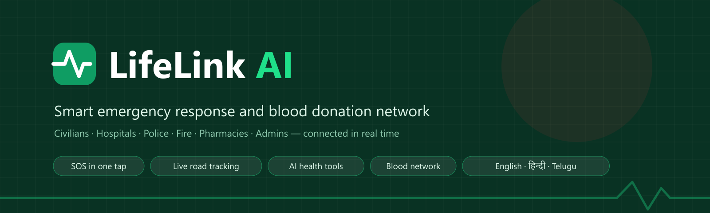

<br>

[](https://lifelinkai-app.vercel.app)
[](https://github.com/ashokvarma1188/LifeLintAi/actions/workflows/tests.yml)


**[Live demo](https://lifelinkai-app.vercel.app)** · **[Try a demo account](#-try-it-in-10-seconds)** · **[Features](#-features)** · **[How it works](#-how-an-sos-works)** · **[Run it locally](#-running-locally)**

</div>

---

## 💡 Why LifeLink

In an emergency in India, help is scattered: **112, 108, 100 and 101** are separate numbers, nobody knows which hospital has a free bed, and blood donors are found through WhatsApp forwards. Minutes are lost exactly when they matter most.

**LifeLink AI puts it all in one place.** A civilian presses **SOS**, says *"help"*, or shakes their phone. Their live location reaches the nearest hospitals, police and fire stations at once. Family get a tracking link, and everyone watches help arrive on the real road route.

<div align="center">

| 🚨 One SOS reaches | 🗺️ Nearest-service lookup | 🌐 Languages | ✅ Automated tests | 📦 First page download |
|:---:|:---:|:---:|:---:|:---:|
| **Hospital · Police · Fire** | **< 1 second** | **3** | **39 / 39 passing** | **~300 KB** |

</div>

<p align="center">
  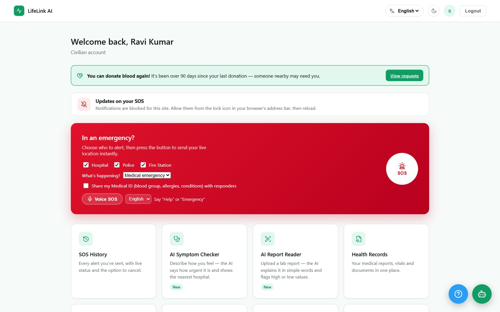
</p>

---

## 🚀 Try it in 10 seconds

Open **[lifelinkai-app.vercel.app/login](https://lifelinkai-app.vercel.app/login)** and tap a button under **"Try a demo account"**. You don't need to sign up.

<table>
<tr>
<td width="55%" valign="top">

| Role | Email | Password |
|---|---|---|
| 👤 Civilian | `ravi@demo.lifelink.app` | `Demo@12345` |
| 🏥 Hospital | `hospital@demo.lifelink.app` | `Demo@12345` |
| 🚓 Police | `police@demo.lifelink.app` | `Demo@12345` |
| 🚒 Fire station | `fire@demo.lifelink.app` | `Demo@12345` |
| 💊 Pharmacy | `pharmacy@demo.lifelink.app` | `Demo@12345` |

> 🔒 **Demo accounts are sandboxed.** They only see each other's alerts. A demo SOS never reaches real responders, and demo responders never see real people's emergencies.

</td>
<td width="45%" valign="top">
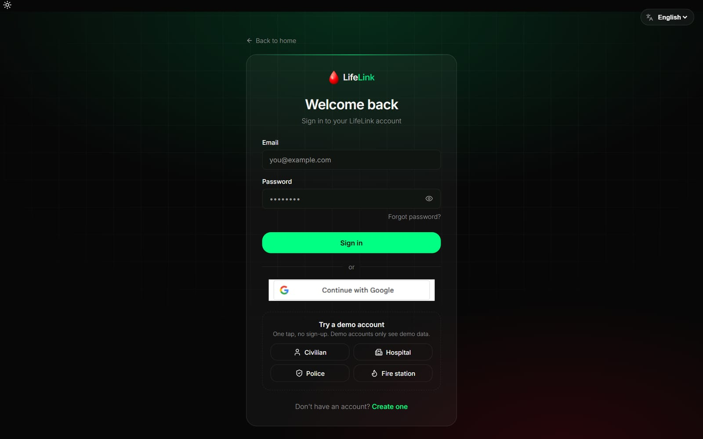
</td>
</tr>
</table>

---

## ✨ Features

### 🚨 Emergency response

<table>
<tr>
<td width="50%" valign="top">
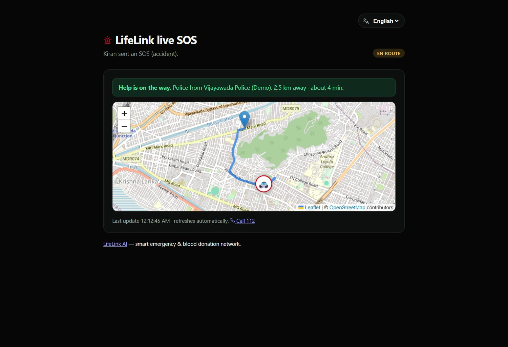
<p align="center"><b>Live tracking on the real road route</b><br><sub>Family open a no-login link and see help approach, with distance and ETA</sub></p>
</td>
<td width="50%" valign="top">
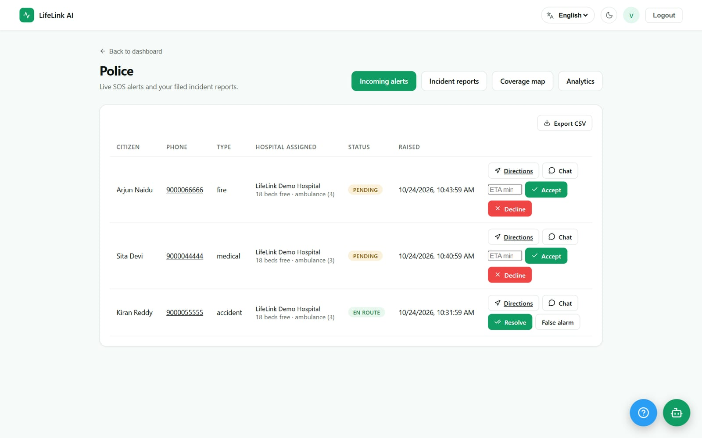
<p align="center"><b>Responder inbox</b><br><sub>Accept with an ETA, mark en route, chat, resolve — alerts filtered by service area</sub></p>
</td>
</tr>
</table>

- **SOS three ways:** a button, **Voice SOS** (*"help"*, *"बचाओ"*, *"సహాయం"*) or **Shake SOS**, each with a 5-second cancel countdown.
- **Nearest responders** found with MongoDB geospatial queries, and alerted with **push notifications**, even when the app is closed.
- **SOS chat** with scene photos and voice notes, plus a **one-tap family alert** over WhatsApp or SMS.
- **Walk with me:** share a trip. A missed check-in brings an *"Are you safe?"* prompt, then an automatic police alert.

### 🤖 AI health tools

<table>
<tr>
<td width="50%" valign="top">
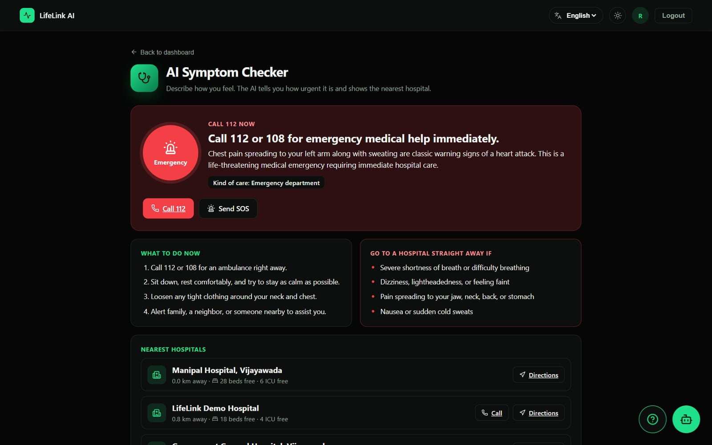
<p align="center"><b>AI Symptom Checker</b><br><sub>Emergency · see a doctor today · home care — plus the nearest hospitals with free beds</sub></p>
</td>
<td width="50%" valign="top">
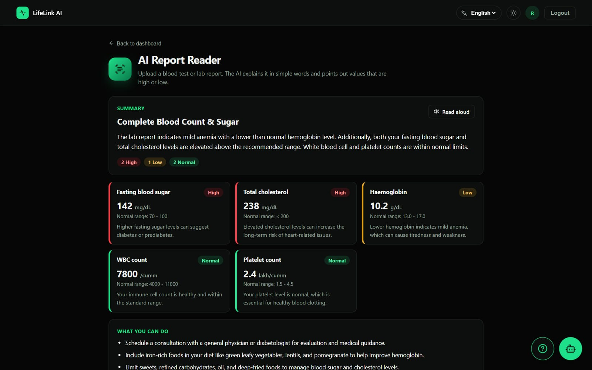
<p align="center"><b>AI Report Reader</b><br><sub>Upload a lab report (photo or PDF) — every value explained, high and low flagged</sub></p>
</td>
</tr>
</table>

- **First-Aid Assistant** chat with photo upload, voice input and read-aloud, answering in the user's language.
- **Safety first:** red-flag symptoms such as chest pain are always treated as an emergency by fixed rules, even if the AI is down. The server falls back across three Gemini models.

### 🩺 Health, blood and learning

<table>
<tr>
<td width="50%" valign="top">
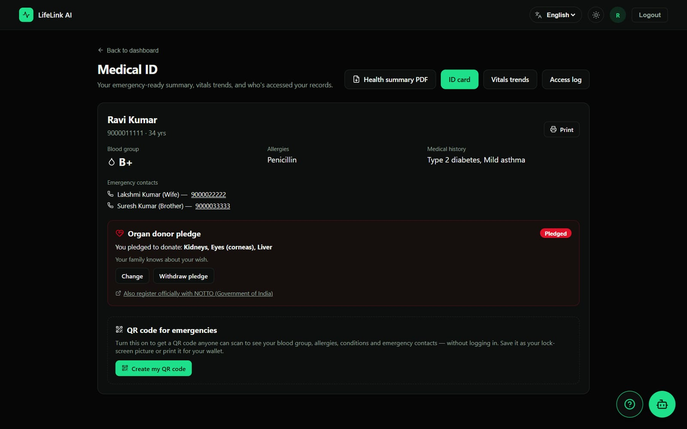
<p align="center"><b>QR Medical ID</b><br><sub>Blood group, allergies and contacts for responders · organ pledge · health summary PDF</sub></p>
</td>
<td width="50%" valign="top">
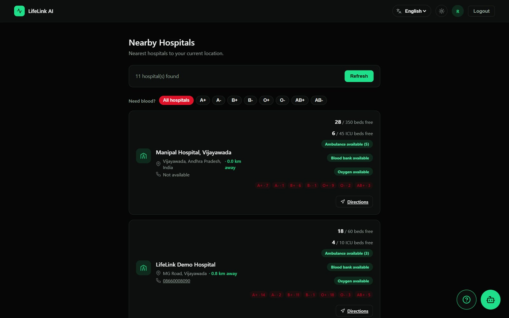
<p align="center"><b>Hospitals and blood stock</b><br><sub>Live beds, ICU, ambulances and blood units per group — filter "who has O− near me"</sub></p>
</td>
</tr>
<tr>
<td width="50%" valign="top">
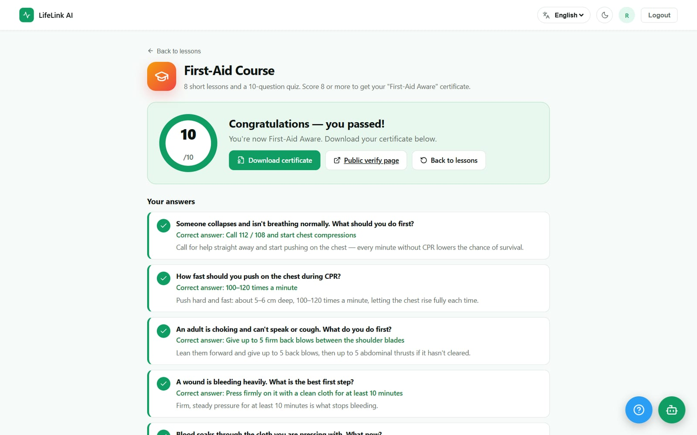
<p align="center"><b>First-Aid Course</b><br><sub>8 lessons and a 10-question quiz, marked on the server</sub></p>
</td>
<td width="50%" valign="top">
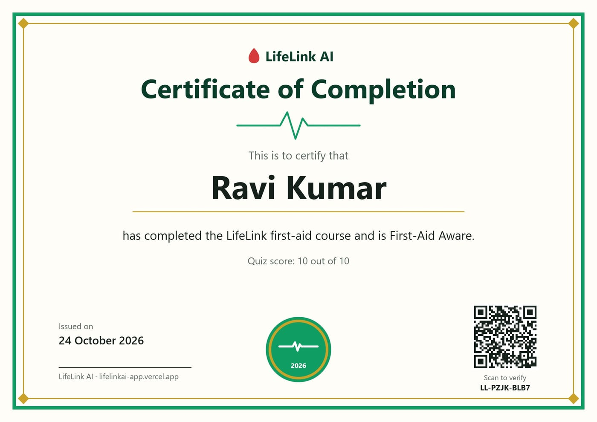
<p align="center"><b>Verifiable certificates</b><br><sub>Scan the QR to check it on a public <code>/verify</code> page</sub></p>
</td>
</tr>
</table>

- **Blood donation** matched by compatibility and distance, with a 90-day rest rule, donor badges and **donation camps**.
- **Health records** with vitals trend charts, **medicine reminders** at every dose, and an **offline first-aid guide** with 14 topics.

### 🛰️ City-wide response

<table>
<tr>
<td width="62%" valign="top">
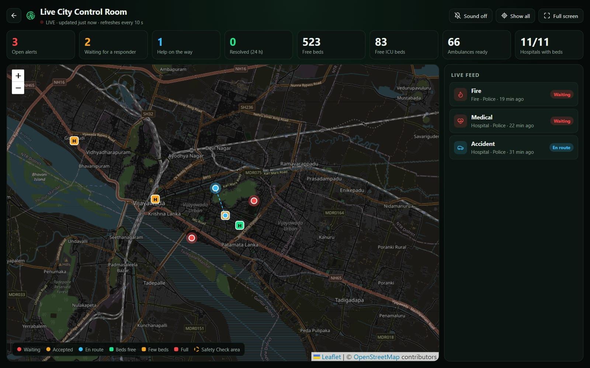
<p align="center"><b>Live City Control Room</b><br><sub>Open alerts, hospital capacity, a live feed and a new-alert sound — for admins and approved responders</sub></p>
</td>
<td width="38%" valign="top">
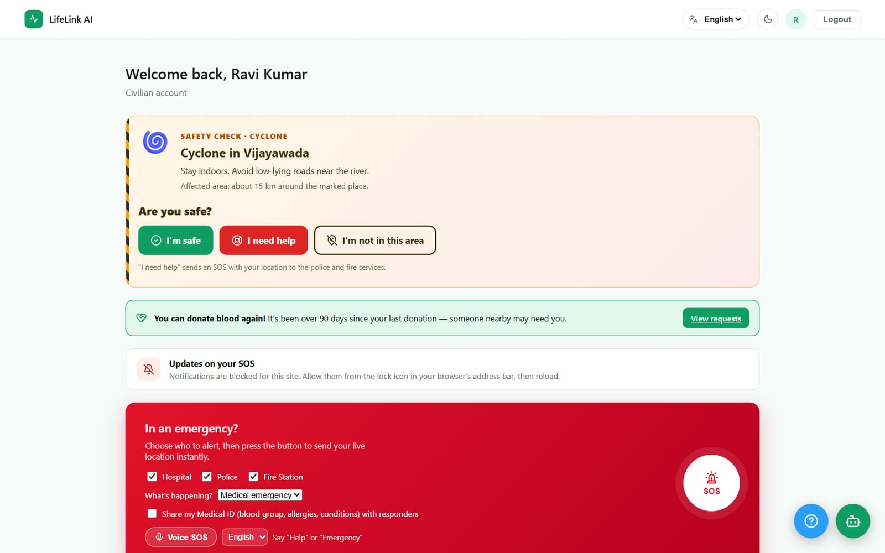
<p align="center"><b>Disaster Safety Check</b><br><sub>Admin marks a flood or cyclone area · everyone is asked "Are you safe?"</sub></p>
</td>
</tr>
</table>

### 🌐 Built for everyone

<table>
<tr>
<td width="70%" valign="top">
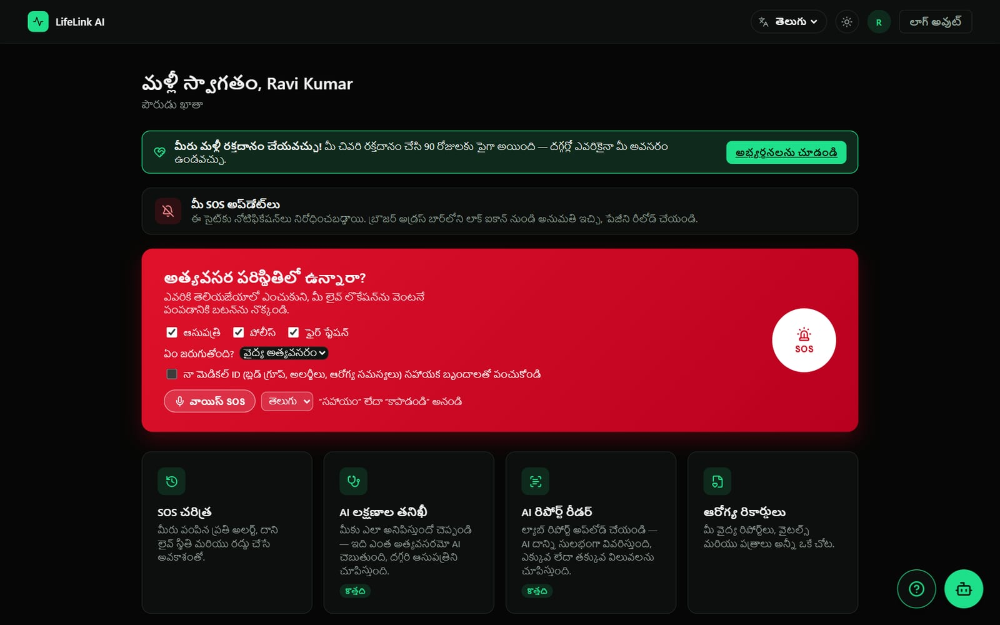
<p align="center"><b>English, Hindi and Telugu</b><br><sub>About 1,330 phrases in each language; the AI answers in the chosen one</sub></p>
</td>
<td width="30%" valign="top" align="center">
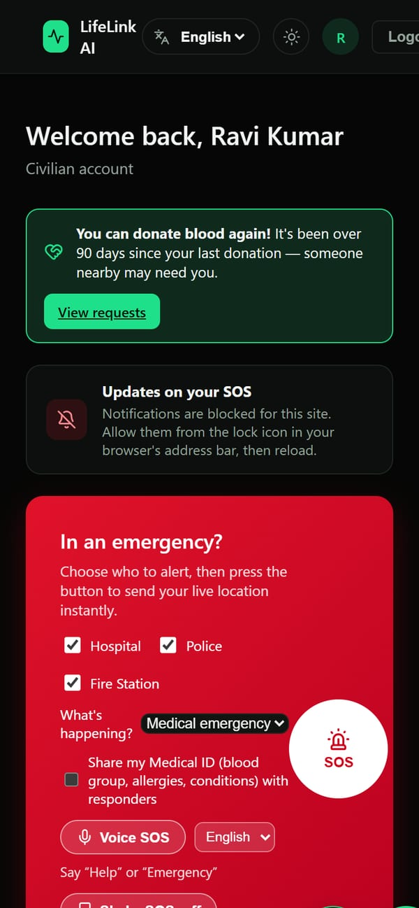
<p align="center"><b>Phone-ready PWA</b><br><sub>Installable, and opens offline after the first visit</sub></p>
</td>
</tr>
</table>

---

## 🧭 How an SOS works

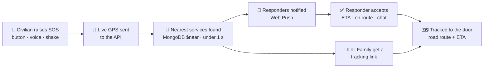

## 🏗️ Architecture

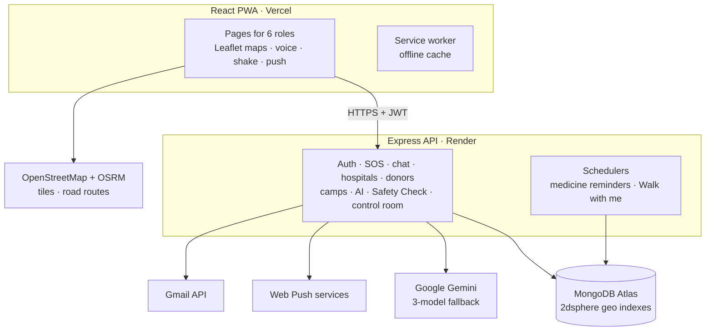

## 👥 Six roles

| Role | What they do | How they join |
|---|---|---|
| 👤 **Civilian** | Sends SOS, tracks help, manages health records, donates blood, uses the AI tools | Open sign-up |
| 🏥 **Hospital** | Updates beds, ICU, ambulances and blood stock; sees incoming patients; runs donation camps | Admin approval |
| 🚓 **Police** | Gets alerts in their area; accepts, goes en route, resolves; files incident reports | Admin approval |
| 🚒 **Fire station** | Fire and rescue calls, fleet status, coverage map, reports | Admin approval |
| 💊 **Pharmacy** | Publishes medicine stock and hours; answers medicine requests | Admin approval |
| 🛡️ **Admin** | Approvals, analytics, audit logs, announcements, control room, Safety Check | Server script only |

---

## 🛠️ Tech stack

| Layer | Technology |
|---|---|
| **Frontend** | React 19 · Vite · React Router 7 · Leaflet · Recharts · service worker (PWA) |
| **Backend** | Node.js 18+ · Express 5 · Mongoose 9 · JWT · bcrypt · Helmet · rate limiting |
| **Database** | MongoDB Atlas with 2dsphere geospatial indexes |
| **AI** | Google Gemini 3.6 Flash → 3.5 Flash → 3.1 Flash-Lite fallback |
| **Maps** | OpenStreetMap tiles · OSRM road routing |
| **Browser APIs** | Geolocation · Web Speech · DeviceMotion · MediaRecorder · Web Push |
| **Email** | Gmail API over HTTPS |
| **PDFs** | Canvas + jsPDF + qrcode, so Hindi and Telugu letters render correctly |
| **Testing** | Node test runner · Supertest · mongodb-memory-server · Playwright |
| **Hosting and CI** | Vercel · Render · GitHub Actions |

<sub>Development tools: VS Code, Git and GitHub, ESLint, and Claude Code as an AI coding assistant.</sub>

## 🔒 Security and privacy

- 🔑 Passwords are hashed with **bcrypt**, and sessions use signed **JWTs**. "Log out everywhere" cancels old tokens.
- 🛂 **Role checks on every API route.** Organisations need admin approval, and admins can only be created by a server script.
- 👁️ Responders see medical details **only when the civilian ticks "Share my Medical ID"**.
- 🔗 Public pages (family tracking, QR Medical ID, certificate check) use **unguessable links** and show no phone numbers or emails.
- 🧪 **Demo accounts are sandboxed** from real users' data.
- 🗑️ Uploaded lab reports are never stored, and users can **delete their account and all their data**.

## ✅ Testing

```bash
cd server
npm test        # 39 tests on a throwaway in-memory database — never the real one
```

The 39 tests cover:
- auth and roles
- SOS matching and status rules
- chat access
- donor rest periods
- medicine reminders
- Medical ID privacy
- blood stock
- Walk with me
- symptom-checker red flags
- report uploads
- Safety Check and control-room access
- donation camps
- quiz marking
- certificates
- the demo sandbox

They run automatically on every push with **GitHub Actions**. Browser tests (Playwright) checked every feature on the live site.

---

## 💻 Running locally

You need **Node.js 18+** and a **MongoDB** connection string (a free MongoDB Atlas cluster works).

```bash
# 1. API
cd server
npm install
cp .env.example .env      # fill in MONGO_URI and JWT_SECRET at least
npm run dev               # http://localhost:5000

# 2. Web app (second terminal)
cd client
npm install
cp .env.example .env      # VITE_API_URL=http://localhost:5000/api
npm run dev               # http://localhost:5173
```

Only `MONGO_URI` and `JWT_SECRET` are required. Without the other keys:
- emails are skipped
- the AI tools are turned off
- Google Sign-In is hidden
- push keys are derived from `JWT_SECRET`

> ⚠️ Local development uses the same database as the live site. Set `DISABLE_PUSH=true` in `server/.env` so a test on your computer never sends real notifications.

See [`server/.env.example`](server/.env.example) for every setting, including the Gmail setup steps.

### Useful scripts (in `server/`)

| Command | What it does |
|---|---|
| `npm run demo:seed` | Adds the sandboxed demo data: a civilian with a full profile, donors, a demo hospital, police and fire station with live alerts, and a donation camp. Run it before a presentation. |
| `npm run demo:reset` | Removes all demo data. |
| `npm run create-admin` | Creates an admin account. There is no way to become admin from the website. |
| `node scripts/seedVijayawada.js` | Adds Vijayawada-area hospitals, police, fire and a pharmacy. |
| `npm test` | Runs the 39 API tests. |

## 📁 Project structure

```
client/                 React app (Vite)
  src/pages/            one file per screen
  src/components/       shared UI — SOS countdown, chat, maps, Safety Check…
  src/i18n/             English / Hindi / Telugu
  src/utils/pdf.js      certificates and health summary PDFs
  public/sw.js          service worker — offline cache and push notifications
server/
  app.js                Express app — routes and middleware
  server.js             database connection, listener, schedulers
  models/ controllers/ routes/ middleware/ utils/
  scripts/              admin, seed and demo-data scripts
  tests/                API tests (node:test + supertest + in-memory MongoDB)
docs/                   README banner and screenshots
.github/workflows/      API tests and keep-awake
```

## ☁️ Deployment

| Part | Where | Notes |
|---|---|---|
| Web app | **Vercel** | Root directory `client`. Set `VITE_API_URL` (ending in `/api`) and `VITE_GOOGLE_CLIENT_ID`. |
| API | **Render** | Root directory `server`, start command `npm start`, with the variables from `.env.example` and `CLIENT_URL` set to the Vercel URL. |
| Keep-awake | Built in | The server pings its own URL every 10 minutes, so Render's free plan never sleeps. A GitHub Actions job is the backup. |
| AI limits | Gemini | The free tier allows about 20 requests per model per day, and the server falls back across 3 models. For heavy use, turn on billing in Google AI Studio. |

## 🗺️ Roadmap

- [ ] Native Android and iOS apps for background crash and fall detection
- [ ] Automatic SMS through a paid gateway
- [ ] Integration with government 112 and 108 systems
- [ ] Ambulance fleet tracking and hospital handover
- [ ] More Indian languages
- [ ] Predictive hotspot maps from SOS history

---

<div align="center">

**LifeLink AI** — from *"something is wrong"* to *"help is on the way"* in one tap.

<sub>Not a replacement for emergency services. In an emergency, always call <b>112</b>.</sub>

</div>
